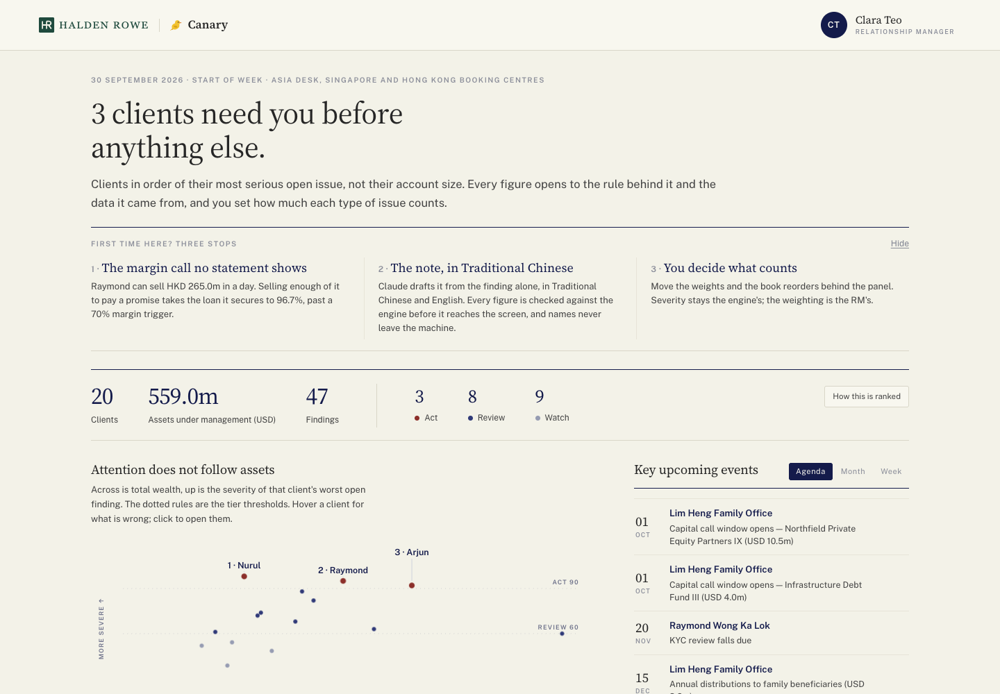
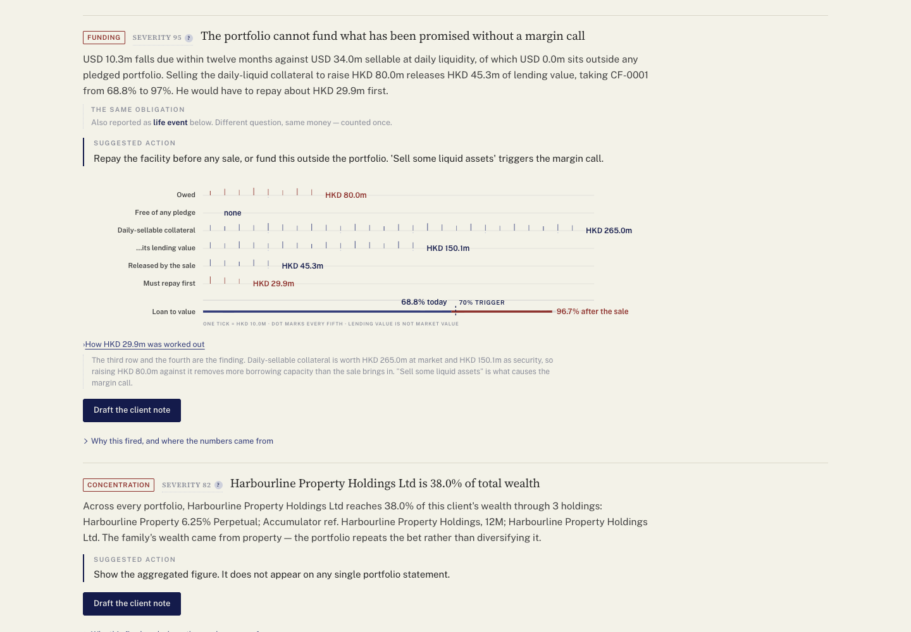
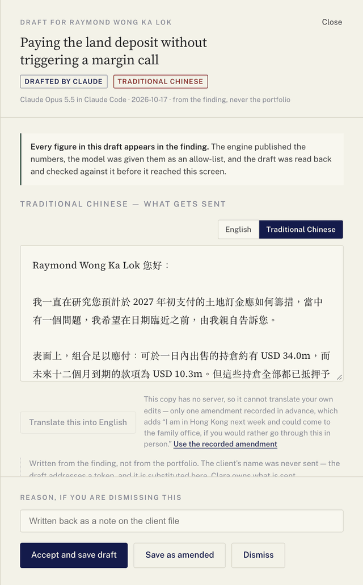

# Canary

**Finds the problem no statement shows.**

**[Open the live demo →](https://isaliana.github.io/canary-private-banking/)**

A workbench for a private-bank relationship manager. It reads a book of twenty
clients, finds the problems hiding between their statements, ranks the clients
by which problem will hurt first rather than by account size, and drafts the
letter to each client in their own language.



## The problem no statement shows

Raymond could sell HKD 265m of holdings in a day, and he needs HKD 80m for a land
deposit. Easy — except those holdings secure his loan. Selling them would push
the loan from 68.8% to 96.7% of what the bank lends against, past the 70% level
that triggers a margin call. Canary finds that, and every figure opens to the
arithmetic behind it.



## What it does

- **Finds eight kinds of problem** — mandate breaches, margin-call risk,
  concentration hidden inside structured products, income that matures too late,
  large upcoming obligations, tax losses and stale valuations.
- **Ranks by consequence**, not by account size. You set how much each kind of
  problem counts, and the book reorders as you do.
- **Proposes the fix** — a trade plan that also says what it will not sell, and
  which rule stopped it.
- **Drafts the client letter** in English and the client's language: Chinese,
  Japanese, Korean, German or Italian.

## AI that cannot change a number

- **AI writes the words; the engine owns the numbers.** Every figure comes from a
  deterministic engine. Each draft is checked against the engine's figures, and
  one that invents a number cannot be sent.
- **Translations are checked the same way.** USD 7.7m cannot quietly become
  770萬美元.
- **Client names never leave the machine.** They are replaced with placeholders
  before any AI call and restored locally.



The letters in the demo were generated in advance. The live AI path is tested
against a simulated API but not deployed, to keep running costs at zero.

## Run it locally

```bash
python3 engine/build.py     # build the findings from data/
open app/index.html         # no server, no install
```

To translate your own edits live, you need an Anthropic API key and a small local
server:

```bash
python3 -m venv .venv && .venv/bin/pip install -r requirements.txt
export ANTHROPIC_API_KEY=sk-ant-...
.venv/bin/python engine/serve.py    # then open http://127.0.0.1:8000/app/
```

## Built with

Python (standard library only) for the engine · plain JavaScript and inline SVG
for the interface, no framework · the Anthropic API for drafting and translation ·
unit tests and headless-browser tests in CI.

All data is synthetic. The bank (Halden Rowe), its staff, the clients, every
company and every market event are invented — see
[the data dictionary](docs/DATA_DICTIONARY.md).

Started at SingHacks 2026 and rebuilt since. The hackathon's dataset isn't used —
everything here runs on synthetic data generated by `data/generate.py`.
